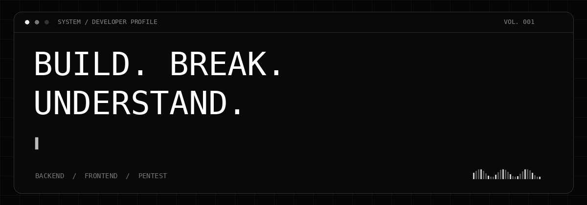
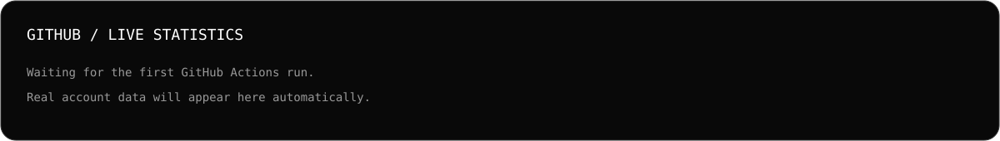
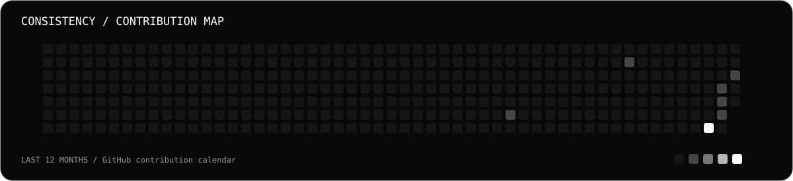
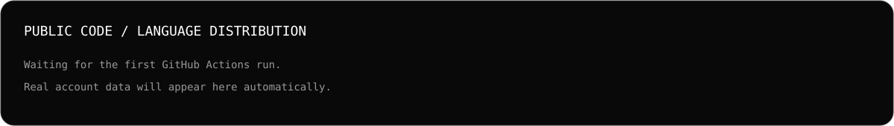

<!-- Replace kyvotdev and yupirut@protonmail.com. Setup: see SETUP.md. -->

[Русский](./README.md) &nbsp; / &nbsp; **English**

 
 

 
 

<samp>BACKEND / FRONTEND / SECURITY / AUTOMATION</samp>

 
 

 
 

 

## `01` / About me

I write code in multiple languages and work across technologies. My focus is **backend development, APIs, secure websites and automation**. I also build frontends, Telegram bots and penetration testing tools. I use **Python, C++ and Rust**, choosing the stack to fit the problem.

> From the interface to the database. From working code to understanding its weaknesses.

 

## `02` / What I do

| Area | What I do |
| :--- | :--- |
| **Backend & API** | Design and build APIs, integrate external services, implement business logic and authentication. FastAPI, Litestar, Django, Django Ninja. |
| **Bots** | Build Telegram bots with aiogram: handlers, interaction flows, API integrations and databases. |
| **Data** | **PostgreSQL is my primary database.** Also work with MariaDB and MongoDB; use SQLAlchemy and Django ORM for schemas, queries and migrations. |
| **Frontend** | Build websites and interfaces with Next.js and Nuxt.js, connecting frontends to backends through APIs. |
| **Automation** | Write scripts and automate browser workflows, data collection and processing with Playwright, Selenium and PyScraper. |
| **Security** | Build websites with security in mind, assess web applications and write custom penetration testing scripts. |

 

## `03` / My stack

<samp>LANGUAGES</samp>

<samp>BACKEND / API / BOTS</samp>

<samp>DATABASES / ORM</samp>

<samp>FRONTEND</samp>

<samp>AUTOMATION / TESTING</samp>

<samp>SYSTEM / VERSION CONTROL</samp>

 

## `04` / Linux & Git

**Linux is my full working environment.** I work in the terminal with shell scripts, SSH, users and permissions, processes and services, systemd, packages, logs, networking and environment configuration. I deploy applications, troubleshoot issues, automate maintenance and pay attention to server hardening.

**Git is part of my daily workflow.** I work with branches and remotes, use merge, rebase and cherry-pick, resolve conflicts, investigate history and recover states with reflog. I keep commit history understandable and collaborate through pull requests.

 

## `05` / Security & privacy

I account for security during development: authentication and authorization, input validation, secret management, access configuration and data protection.

I can assess a website's security by examining APIs, sessions, access controls and configuration, identifying weaknesses and suggesting fixes. I write custom scripts and automation for penetration testing and repeatable checks.

**Online privacy and anonymity** are another area of interest: reducing digital footprints, protecting personal data, isolating environments and understanding what applications and network services reveal.

 

## `06` / Open source

I value **open source**: accessible code, transparent solutions and shared knowledge. I build tools that can be studied, extended and reused. I enjoy exploring other implementations and sharing what I learn.

 

## `07` / GitHub activity

 

 

Statistics update automatically. Language distribution reflects code size in public, owned, non-fork repositories, rather than proficiency.

 
 

---

 

<samp>BUILD WITH PURPOSE. QUESTION EVERY ASSUMPTION.</samp>

 
 

[Русский](./README.md) &nbsp; / &nbsp; **English**

 

