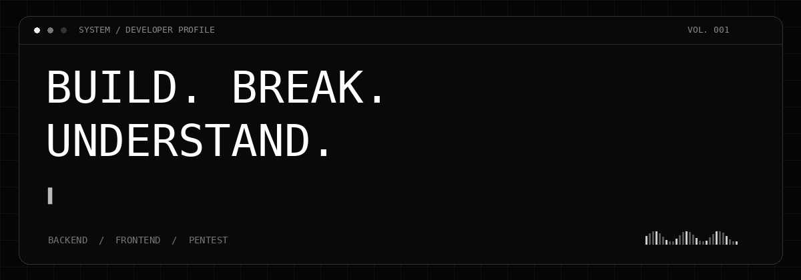
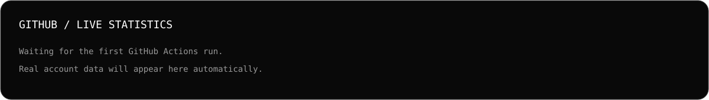
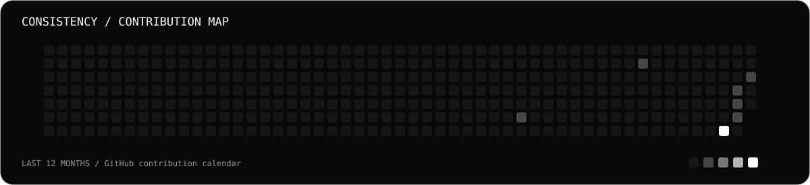
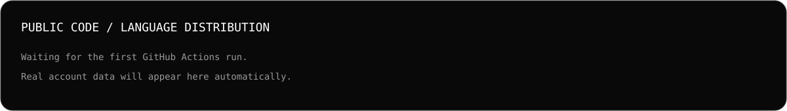

**Русский** &nbsp; / &nbsp; [English](./README.en.md)

 
 

 
 

<samp>BACKEND / FRONTEND / SECURITY / AUTOMATION</samp>

 
 

 
 

 

## `01` / Обо мне

Пишу код на разных языках и работаю с разными технологиями. Мой фокус — **backend, API, безопасные сайты и автоматизация**. Разрабатываю frontend, Telegram-ботов и инструменты для тестирования на проникновение. Использую **Python, C++ и Rust**; стек выбираю под задачу.

> От интерфейса до базы данных. От работающего кода до понимания его уязвимостей.

 

## `02` / Что я делаю

| Направление | Что делаю |
| :--- | :--- |
| **Backend & API** | Проектирую и разрабатываю API, интегрирую внешние сервисы, реализую бизнес-логику и аутентификацию. FastAPI, Litestar, Django, Django Ninja. |
| **Bots** | Создаю Telegram-ботов на aiogram: обработчики, сценарии взаимодействия, интеграции с API и базами данных. |
| **Data** | **PostgreSQL — основная БД.** Также работаю с MariaDB и MongoDB; использую SQLAlchemy и Django ORM, проектирую схемы, запросы и миграции. |
| **Frontend** | Разрабатываю сайты и интерфейсы на Next.js и Nuxt.js, соединяю frontend с backend через API. |
| **Automation** | Пишу скрипты, автоматизирую браузерные сценарии, сбор и обработку данных. Playwright, Selenium, PyScraper. |
| **Security** | Создаю сайты с учётом безопасности, провожу проверки веб-приложений и пишу собственные скрипты для пентеста. |

 

## `03` / Мой стек

<samp>LANGUAGES</samp>

<samp>BACKEND / API / BOTS</samp>

<samp>DATABASES / ORM</samp>

<samp>FRONTEND</samp>

<samp>AUTOMATION / TESTING</samp>

<samp>SYSTEM / VERSION CONTROL</samp>

 

## `04` / Linux & Git

**Linux — полноценная рабочая среда.** Работаю из терминала: shell-скрипты, SSH, пользователи и права доступа, процессы и службы, systemd, пакеты, логи, сеть и настройка окружения. Разворачиваю приложения, разбираюсь с неполадками, автоматизирую обслуживание и уделяю внимание защите сервера.

**Git — ежедневный рабочий инструмент.** Работаю с ветками и удалёнными репозиториями, использую merge, rebase и cherry-pick, разрешаю конфликты, разбираюсь в истории изменений и восстанавливаю нужные состояния через reflog. Поддерживаю понятную историю коммитов и работаю через pull requests.

 

## `05` / Безопасность и приватность

Безопасность учитываю при разработке: аутентификация и авторизация, проверка входных данных, работа с секретами, настройки доступа и защита данных.

Могу протестировать сайт на безопасность: проверить API, сессии, права доступа и конфигурацию, найти слабые места и предложить исправления. Для тестирования на проникновение и повторяемых проверок пишу собственные скрипты и автоматизацию.

**Приватность и анонимность в сети** — отдельная область интереса: минимизация цифрового следа, защита личных данных, изоляция окружений и понимание того, какую информацию раскрывают приложения и сетевые сервисы.

 

## `06` / Open source

Ценю **open source**: открытый код, прозрачные решения и обмен знаниями. Создаю инструменты, которые можно изучать, дорабатывать и использовать повторно. Мне интересно разбирать чужие реализации и делиться своими находками.

 

## `07` / Активность на GitHub

 

 

 
 

---

 

<samp>BUILD WITH PURPOSE. QUESTION EVERY ASSUMPTION.</samp>

 
 

**Русский** &nbsp; / &nbsp; [English](./README.en.md)

 

